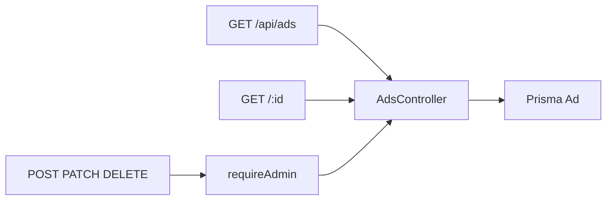

# Ads

`src/routes/ads.js` → `src/services/ads.controller.js`. Schema: `src/validation/ads.schema.js`.

`placement` values include `job_list_top`, `middle_of_job_list`, `home_page_after_pagenation_1`, `home_page_after_pagenation_2`, `company_list_top`, `service_list_top`, and the related-item slots. `activeOnly=true` keeps ads inside `startAt` / `endAt`.
