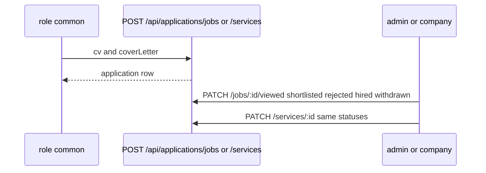

# Applications

`src/routes/applications.js` → `src/services/applications.controller.js`. Schema: `src/validation/applications.schema.js`.

`GET /jobs` and `GET /services` are admin-only. Status changes are `admin` or `company`. Files use the shared `upload` middleware (`FILE_UPLOAD_LIMIT_BYTES`).
