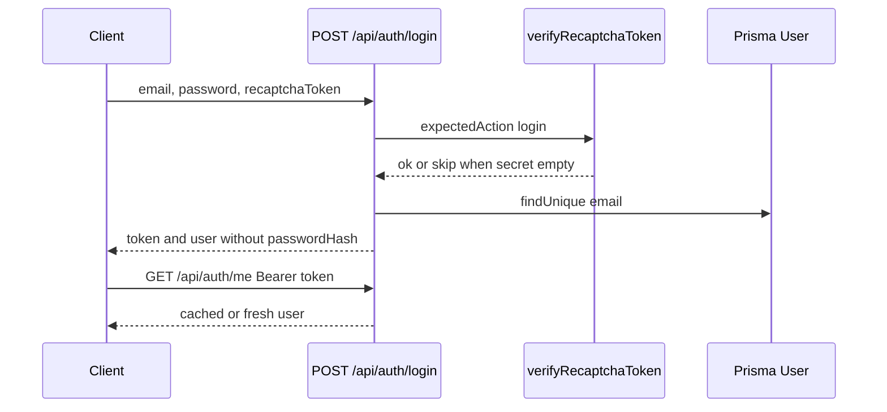

# Auth

`src/routes/auth.js` → `src/services/auth.controller.js`. JWT helpers: `src/utils/jwt.js`. Request user: `src/middleware/authn.js`.

Login is rate-limited (`LOGIN_RATE_LIMIT_POINTS`). On Vercel that limiter is process-local because Redis is off. `RECAPTCHA_SECRET_KEY` empty means the server does not reject a missing token.
