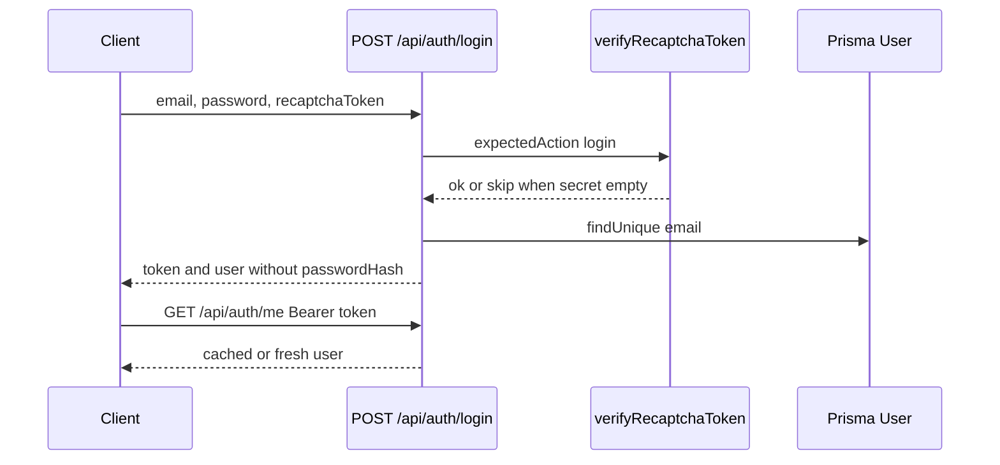

# Auth

`src/routes/auth.js` → `src/services/auth.controller.js`. JWT helpers: `src/utils/jwt.js`. Request user: `src/middleware/authn.js`.

Login is rate-limited (`LOGIN_RATE_LIMIT_POINTS`). On Vercel that limiter is process-local because Redis is off. `RECAPTCHA_SECRET_KEY` empty means the server does not reject a missing token, including in production.

Google sign-in stays on the same JWT. The Next.js app starts the OAuth redirect at `/api/auth/google` and posts the Google ID token to `POST /api/auth/google`. A matching email keeps its role and password. A new visitor is created as `common` with `googleSub` set. `GOOGLE_CLIENT_ID` must be set on the API. The frontend also needs `GOOGLE_CLIENT_SECRET` and redirect URI `https://jobs.devminds.net/api/auth/google/callback`.
