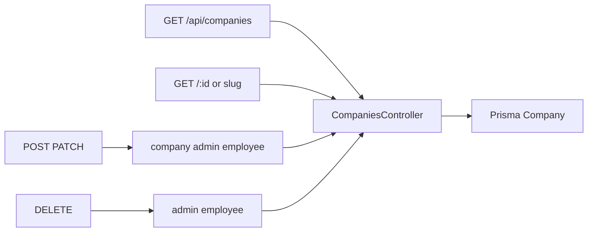

# Companies

`src/routes/companies.js` → `src/services/companies.controller.js`. Schema: `src/validation/companies.schema.js`.

A company user is tied to `User.companyId`. City is an optional relation.
