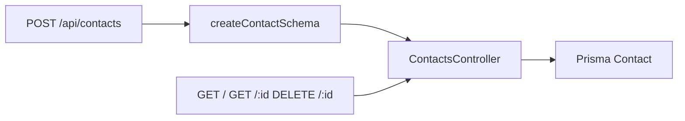

# Contacts

`src/routes/contacts.js` → `src/services/contacts.controller.js`. Schema: `src/validation/contacts.schema.js`.

The public site form is `src/components/sections/contact-form.client.tsx` in the Next.js app. Listing and delete are for staff screens.
