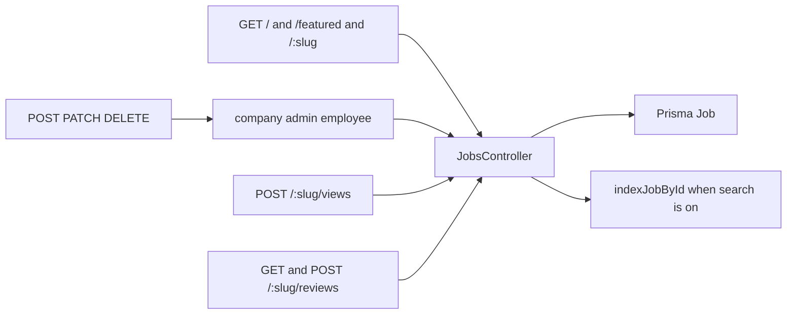

# Jobs

`src/routes/jobs.js` → `src/services/jobs.controller.js`. Schema: `src/validation/jobs.schema.js`.

List filters include `q`, `location`, `type`, `page`, `pageSize`. `type` is `full_time`, `part_time`, `contract`, `internship`, `temporary`, or `remote`. Skills are a comma-separated string. Public GETs send `Cache-Control: public, max-age=60`.
