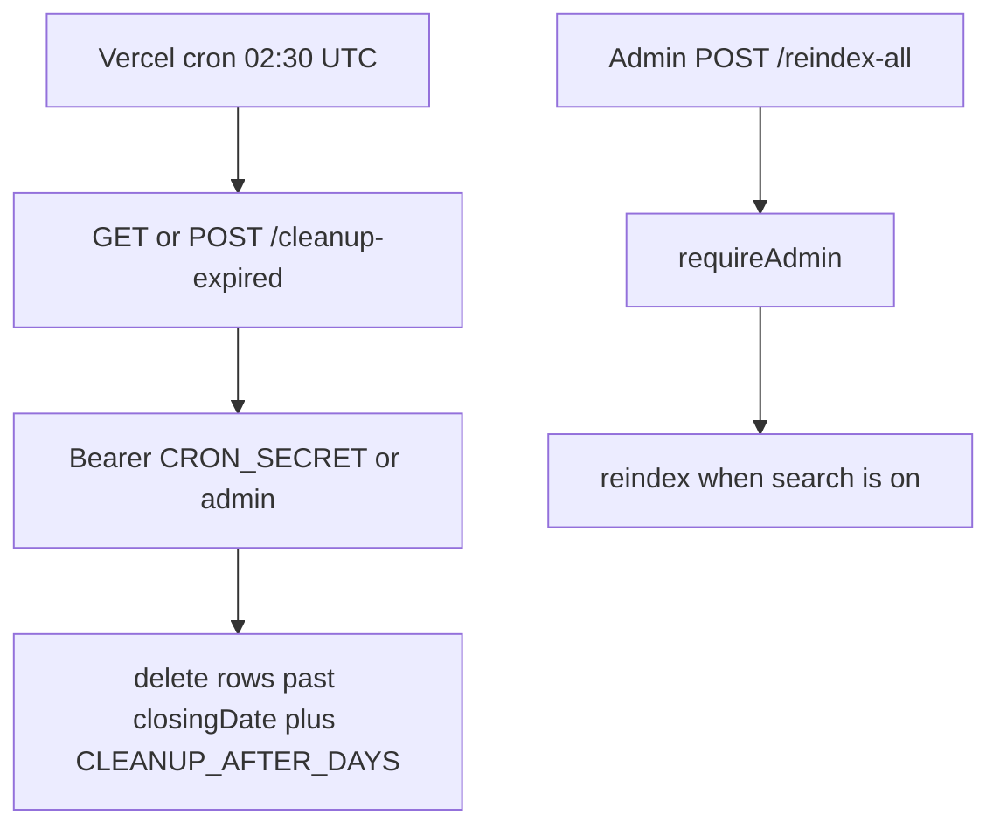

# Maintenance

`src/routes/maintenance.js` → `src/services/maintenance.controller.js`. Cron auth uses `CRON_SECRET`.

`CLEANUP_DRY_RUN=true` lists without deleting. On a VPS the repeatable job is `src/queue/cleanupScheduler.js` instead of Vercel Cron. Reindex is a no-op while `SEARCH_ENABLED` is forced off.
