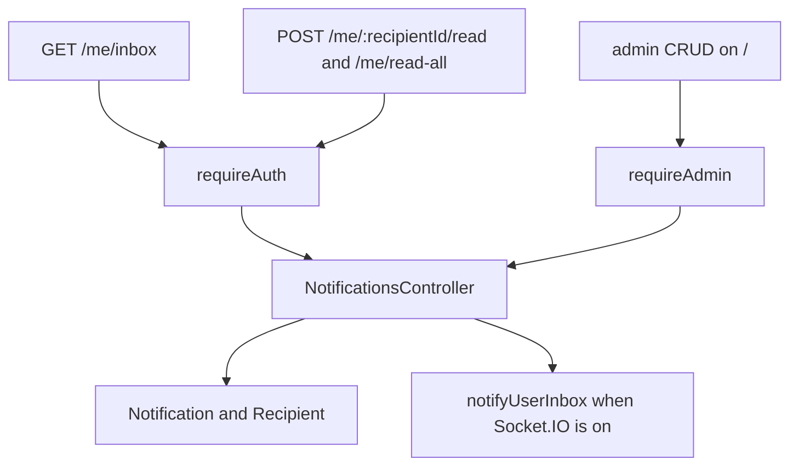

# Notifications

`src/routes/notifications.js` → `src/services/notifications.controller.js`. Schema: `src/validation/notifications.schema.js`. Realtime: `src/lib/ws.js` and `src/lib/notify.js`.

On free Vercel, Socket.IO is off. The inbox still works over HTTP. Rooms on a VPS are `user:ID` and `company:ID`.
