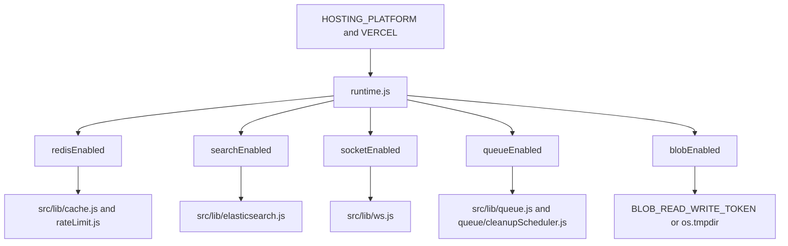

# Platform flags

`src/lib/runtime.js` decides what a process is allowed to start. `src/index.js` listens only when `VERCEL` is not set. On Vercel, `api/index.js` exports the Express app.

Free Vercel: all four of Redis, search, sockets, and queues are forced off. Cleanup runs from the Vercel cron in `vercel.json` (`GET /api/maintenance/cleanup-expired` at 02:30 UTC). Hobby allows 10 seconds per invocation.

VPS (`HOSTING_PLATFORM=local`): set `REDIS_URL`, `ELASTICSEARCH_URL`, and `SOCKET_IO_ENABLED=true`. The image worker is `npm run worker`.
