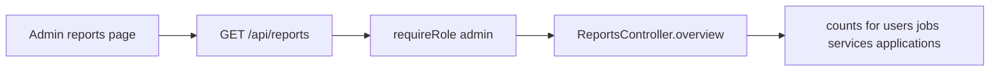

# Reports

`src/routes/reports.js` → `src/services/reports.controller.js`. Admin only.

The frontend charts today, this week, this month, a 30-day series, and top viewed jobs. CSV export is a frontend concern.
