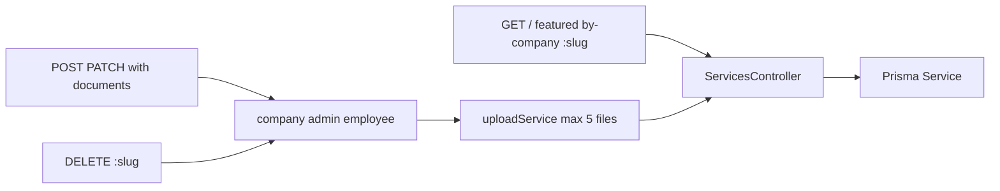

# Services

Procurements and scholarships. `src/routes/services.js` → `src/services/services.controller.js`. Schema: `src/validation/services.schema.js`.

Query: `type`, `status`, `q`, `cityId`, `featured`, `page`, `pageSize`. Upload limit: `SERVICE_UPLOAD_LIMIT_BYTES` (default 10MB). On Vercel, files need `BLOB_READ_WRITE_TOKEN` or they live only in the function temp directory.
