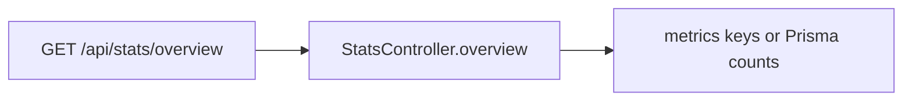

# Stats

`src/routes/stats.js` → `src/services/stats.controller.js`. Counters: `src/lib/metrics.js`.

When Redis is off, metric increments in controllers are ignored and overview should read the database. The route is also marked for the WebSocket subscribe hint in `src/app.js`, which is a no-op on Vercel.
