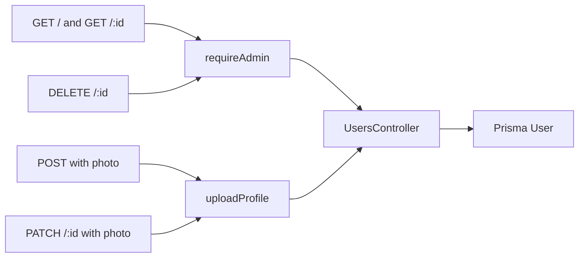

# Users

`src/routes/users.js` → `src/services/users.controller.js`. Schema: `src/validation/users.schema.js`.

Roles: `common`, `company`, `admin`, `employee`. Photo limit: `PROFILE_UPLOAD_LIMIT_BYTES` (default 5MB). Seed admin comes from `ADMIN_EMAIL` and `ADMIN_PASSWORD`.
